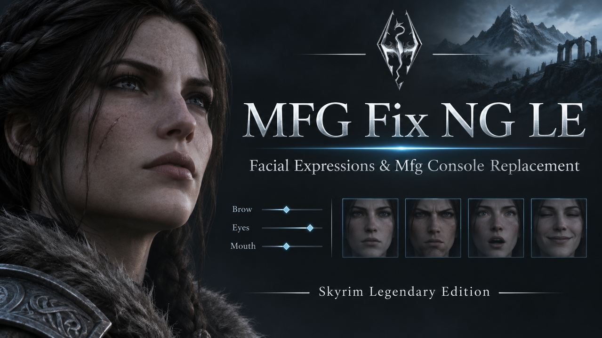

# MFG Fix NG LE



**Facial expressions, smooth transitions, and integrated Mfg Console replacement for Skyrim Legendary Edition.**

    

**LE adaptation by [Mhacks79](https://github.com/Mhacks79)**, based on **[Mfg Fix NG by KrisV-777](https://github.com/KrisV-777/Mfg-Fix-NG)** and **[Mfg Fix by andrelo1](https://github.com/andrelo1/mfgfix)**.

> **Current status:** Version **1.0.13 — Test Build 5** (20 November 2026). Facial-expression support was confirmed in-game on an earlier build. The new integrated Mfg Console replacement passes offline validation but **has not yet been confirmed in a live game in Test Build 5**. This is a test release, not a guarantee of compatibility with every mod setup.

## Features

- Control facial **expressions, phonemes and modifiers**, including expression ID 0 and morph strengths from **0–200%**.
- Smooth facial transitions and resets, with configurable timing and immediate legacy behavior by default.
- **MfgConsoleFunc** and **MfgConsoleFuncExt** Papyrus APIs, including presets, expression state reads, dialogue state, and the player speech target.
- **Mfg Console replacement (new in 1.0.13):** actor facial-data table, selected-reference information, extra info panel, `mfg` commands and aliases, player blinking, `getmoditem`, and `savebat`.
- Main-thread dispatch, facial-data checks, save/load request cancellation, and cleanup of stale transitions.
- Native **SKSE x86** DLL; **no ESP, Address Library, SkyUI, FNIS, or Nemesis** required.

## Requirements

| Component | Required version |
| --- | --- |
| Game | **Skyrim Legendary Edition 1.9.32.0.8** |
| Script Extender | **SKSE 1.7.3** |
| Platform | Windows, **32-bit Skyrim LE** |

**Not for Skyrim Special Edition / Anniversary Edition.**

## Installation (Mod Organizer 2)

1. Install the **1.0.13 Test Build 5** ZIP as a normal MO2 mod. The ZIP root already corresponds to the game's **Data** folder.
2. Keep the original Mfg Console interface files installed: `Interface/console.swf` and `Interface/console_alias.ini`. The interface is supplied by the original Mfg Console installation or another mod that bundles it, **not by this archive**.
3. To use **the integrated replacement**, hide/disable **`SKSE/Plugins/MfgConsole.dll`**, including any second copy supplied by another mod.
4. Put MFG Fix NG LE **below the original Mfg Console mod** in MO2's left pane so that its `Scripts/MfgConsoleFunc.pex` takes precedence.
5. Do **not** install the old LE `mfgfix.dll` alongside this plugin.
6. Start Skyrim with **`skse_loader.exe`**.

**Coexistence option:** If `MfgConsole.dll` is still loaded, that DLL continues providing the console interface. MFG Fix NG LE provides the Papyrus API and its NG-specific commands instead of taking over the original console features.

## Configuration

Edit `Data/SKSE/Plugins/MfgFixNGLE.ini` and restart the game.

```ini
[Transition]
fDefaultSpeed=0.00

[Console]
bPassToMfgConsole=1

[MfgConsole]
bReplace=1
bPlayerBlink=1
bExtraInfo=1

[Debug]
EnableLog=0
```

- `fDefaultSpeed=0.00`: immediate legacy changes; `0.75` gives a smoother default. Supported values: 0–10 seconds.
- `bPassToMfgConsole=1`: with the original DLL loaded, pass ordinary `mfg` console commands to it.
- `bReplace=1`: replace Mfg Console's native functionality when its DLL is absent.
- `bPlayerBlink=1`: enable the replacement's player blinking feature.
- `bExtraInfo=1`: enable the extended reference information panel.
- `EnableLog=1`: enable `Documents/My Games/Skyrim/SKSE/MfgFixNGLE.log`. Logging is off by default.

## Quick test in game

Select the player with `prid 14` (or select a living NPC), then try:

```text
mfg ngstatus
mfg ngsmile
mfg nganger
mfg ngmouth
mfg ngbrows
mfg ngmoodzero
mfg ngreset
```

**Close the console** to see the transitions. The console pauses the game. For facial inspection, third-person mode and `tfc` can help; avoid `tfc 1` or other paused-time modes during testing.

## Compatibility and limitations

This port targets the **expression API**, not a byte-for-byte replacement of all Special Edition Mfg Fix NG engine changes. Skyrim LE continues managing native dialogue, eye movement and blinking. The SE-only `EyesBlinking`, `EyesMovement`, `Dialogue`, and `MFGFIX_Settings` overrides are **not implemented**. Some facial compositions and transition details may differ from SE. An SE mod/ESP does **not** become LE-compatible merely because it uses this Papyrus API.

The plugin creates **no custom cosave records**; existing saves can be used. Real-world compatibility with different LE mod combinations needs testing.

## Build, sources and validation

The full **LE-specific C++ source tree**, Papyrus interfaces, native build projects, fake-engine harness, and regression tests are published here under [`Source/Port`](Source/Port) and [`Source/harness`](Source/harness). The original distribution archive also contains upstream source snapshots and the **SKSE 1.7.3 SDK**, which are external dependencies and are **not vendored into this repository**. To build, obtain the exact SKSE SDK from the original distribution/archive or its official publisher and place it in `Source/original-skse-sdk`.

The port builds with **Visual Studio 2022**, Win32 toolchain v143 and the **SKSE 1.7.3 SDK**. The distributed source tree documents `Source/Port/Build.ps1` and `Build.ps1 -Harness`. See [build notes](docs/BUILD.md) and [validation status](docs/VALIDATION.md).

### Test Build 5 validation

The supplied validation log reports **2,217 offline harness checks, 0 failures**; **21/21 console-replacement mutations** and **7/7 engine mutations** detected. These are **fake-engine / offline checks**, **not** full Skyrim runtime verification.

## Credits

- **[KrisV-777](https://github.com/KrisV-777/Mfg-Fix-NG)** — original Mfg Fix NG.
- **[andrelo1](https://github.com/andrelo1/mfgfix)** — original Mfg Fix.
- **[antpillager](https://github.com/antpillager/mfgfix)** — original animation work referenced by NG.
- **kapaer** — original LE Mfg Console.
- **SKSE team** — Skyrim Script Extender.
- **Mhacks79** — Legendary Edition port, integration, research and validation.

**License:** GNU GPL v3 with upstream [linking exceptions](EXCEPTIONS.md). Original author credits and license notices must be retained in redistributed source.

**Support development:** [Ko-fi — Mhacks79](https://ko-fi.com/mhacks79).
